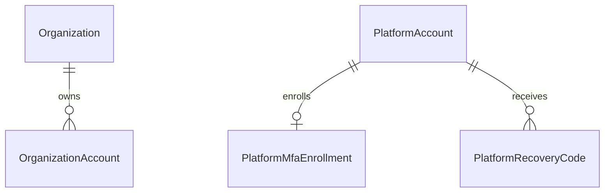

# Identity data model proposal

Status: Proposed for review; approval to write this document is not approval of its schema.

Prepared: 2026-11-12

## Scope and approved baseline

This document proposes a minimal logical model, not production tables, EF Core entities, or migrations. The [master specification](../../GeoSurvey_Master_Architecture_and_Codex_Spec.md) remains authoritative. ASP.NET Core Identity with EF Core was subsequently selected in record 0010; no packages or physical schema are introduced here.

Approved decisions:

- [0003](../decisions/0003-separate-organization-accounts.md): separate accounts and credentials per organization, including when email is reused.
- [0004](../decisions/0004-organization-code-login.md) and [0005](../decisions/0005-organization-code-rules.md): organization code + email + password; normalized, platform-wide unique, fixed organization codes.
- [0006](../decisions/0006-platform-administrator-accounts.md): separate platform-scoped accounts with dedicated email/password login; no automatic tenant-data access.
- [0007](../decisions/0007-first-platform-administrator-bootstrap.md): first administrator created by controlled operator-run bootstrap, without default credentials or overwrite/reset behavior.
- [0008](../decisions/0008-platform-administrator-mfa.md): mandatory platform-admin TOTP enrollment before platform access and single-use recovery codes; reset/recovery workflow remains open.
- [0009](../decisions/0009-account-email-rules.md): trim surrounding whitespace, reject embedded whitespace, case-insensitive invariant lookup, preserve display address, and enforce email uniqueness within organization/platform scopes without linking accounts or removing dots/tags.
- [0010](../decisions/0010-aspnet-core-identity-ef-core.md): ASP.NET Core Identity with EF Core in Infrastructure, customized for account scopes and application flows; physical mappings remain proposed.
- DB-001: identities and tenant registry share a global control-plane database. Operational data stays in each organization's own database.
- Specification sections 6.4-6.5: internal integer IDs, unique public GUID identifiers for externally identified records, and persisted timestamps in UTC. Account GUID generation was subsequently approved in [record 0012](../decisions/0012-account-identifiers-and-usernames.md); generation for other entity types remains open.

## Proposed records

Physical strategy update: [record 0011](../decisions/0011-scoped-single-account-table.md) accepts one Identity account table with explicit scope and scoped email uniqueness. OrganizationAccount and PlatformAccount below remain logical concepts mapping to independent rows in that table, not separate accepted physical tables. MFA/recovery mappings and other candidate fields remain proposed.

Names and fields below are candidates. Exact types, lengths, SQL schemas, identity-library mappings, and lifecycle fields need review before implementation.

| Record | Candidate fields | Responsibility |
| --- | --- | --- |
| Organization | `Id`, `PublicId`, `Code`, `DisplayName`, `CreatedAtUtc` | Organization identity; links to the separately designed tenant registry/provisioning model |
| OrganizationAccount | `Id`, `PublicId`, `OrganizationId`, `Email`, `NormalizedEmail`, `PasswordHash`, `CreatedAtUtc` | Credentials owned by exactly one organization |
| PlatformAccount | `Id`, `PublicId`, `Email`, `NormalizedEmail`, `PasswordHash`, `CreatedAtUtc` | Platform-scoped credentials independent of organization accounts |
| PlatformMfaEnrollment | `Id`, `PlatformAccountId`, `ProtectedTotpSecret`, `ConfirmedAtUtc` | Proposed association for authenticator enrollment; unconfirmed enrollment must not grant platform access |
| PlatformRecoveryCode | `Id`, `PlatformAccountId`, `CodeHash`, `ConsumedAtUtc` | Proposed per-account recovery-code record with single-use tracking |

`NormalizedEmail` follows [record 0013](../decisions/0013-email-validation-contract.md): Identity uppercase invariant normalization of a validated, trimmed ASCII email of at most 254 characters. Implementation remains pending. `Email` preserves the trimmed display address. `PasswordHash` represents the application's credential mechanism, not a chosen hashing algorithm or final physical column. Exact TOTP-secret protection and recovery-code hashing mechanisms remain undecided. Secret/hash fields are never public DTO fields. Internal-only MFA/recovery records do not need public routes just because other records have `PublicId`.

Platform permissions remain subject to explicit authorization. A PlatformAccount row alone must not imply full administrative access; its binding to platform roles/permissions is outside this minimal credential model. Similarly, organization roles, memberships in projects, and area assignments remain separate tenant-side authorization concerns.

## Relationships

Each organization account has one required organization association. Two accounts with the same email in different organizations remain distinct principals. Platform accounts have no OrganizationId in this proposal. No account-link or shared-person record is introduced.

An enrollment is optional in storage because newly bootstrapped accounts may still need enrollment. That does not make MFA optional for platform administration. The confirmation/session protocol must establish that the second factor was verified, rather than trusting a non-null field alone. Modeling one enrollment per platform account is a proposal, not an approved multi-device policy.

The diagram omits registry, sessions, roles, and audit relationships intentionally; it is not a complete control-plane ERD.

## Candidate constraints

| Constraint | Basis/status |
| --- | --- |
| Unique `Organization.Code` after approved normalization | Approved behavior; database enforcement not implemented |
| Required `OrganizationAccount.OrganizationId` referencing Organization | Proposed relational expression of approved account ownership |
| Unique `(OrganizationId, NormalizedEmail)` | Scope/uniqueness behavior approved in record 0009; physical constraint remains proposed |
| Unique `PlatformAccount.NormalizedEmail` within platform-account scope | Scope/uniqueness behavior approved in record 0009; physical constraint remains proposed |
| Unique `PublicId` for externally identified organization/account records | Specification baseline; account generation approved in record 0012, exact mapping and other entity generation remain open |
| Unique `PlatformMfaEnrollment.PlatformAccountId` | Proposed one-enrollment association; not yet approved |
| Recovery-code record must belong to one platform account | Proposed ownership mapping of approved recovery-code policy |

Do not impose global uniqueness across organization-account emails. Do not link platform and organization accounts by email. Organization-code uniqueness is independent of email rules.

Unique constraints protect against concurrent duplicate creation; application pre-checks alone are insufficient. The exact constraint/index strategy, account-deletion treatment, and foreign-key delete behavior remain undecided. No cascade deletion policy is assumed.

## Authentication and tenant boundary

Organization login selects the registry organization by approved code, then verifies credentials for the account in that organization. A supplied code is not authorization and is never used directly as a database name or connection string. Operational database routing must be based on trusted registry data and the authenticated organization account.

Platform login uses the platform-account scope, with mandatory MFA before platform operations. Matching email addresses do not merge scopes or credentials. Tokens/sessions must unambiguously distinguish these principals; their exact claims and storage are future design work.

Bootstrap must create only the first eligible platform administrator under a safe concurrency guard. This document does not specify how the account is assigned administrative permissions, how operator authorization works, or how disabled/deleted accounts affect eligibility.

## MFA and secret storage considerations

The proposed MFA record needs a recoverable, protected secret to verify TOTP. The exact protection mechanism, key management, rotation, and storage format require review. Passwords and recovery codes should not be recoverable from their stored representations; implementations must select appropriate mechanisms and avoid logging secrets.

Single-use recovery-code consumption needs an atomic operation scoped to the intended platform account. Generation, regeneration/invalidation, and recovery authorization remain open. The fields shown do not define a usable recovery workflow by themselves.

## Explicitly deferred

- Implementation of the approved email contract in record 0013, exact SQL mapping/collation, and email-change/verification workflows. Validator, length, ASCII-only handling, and normalizer selection are now settled.
- Whether separate logical account records become separate physical tables or another enforceable Identity/EF Core representation. Framework selection is approved in record 0010; defaults and customizations still require review.
- Account verification, lockout, disabling/deletion, concurrency, and password policy.
- MFA parameters, enrollment protocol, replay/attempt controls, reset, and administrative recovery.
- Refresh-token families, rotation/reuse detection, access-token claims, revocation, and session persistence (requirements remain in the master specification).
- Region and tenant database registry/provisioning fields; organization-account data is not moved into tenant databases.
- Audit event design, platform role/permission mapping, onboarding, and later administrator management.

## Verification to add with implementation

Future tests should demonstrate that the same email can identify independent accounts in different organizations, a code cannot grant access without credentials, platform authentication cannot imply tenant access, and database constraints prevent concurrent duplicates under the approved rules. MFA and recovery tests must cover enrollment gating and atomic single use; bootstrap tests must cover concurrency and no-overwrite behavior.

No tests are executed for this proposed model. Implementation and its tests require separate scope approval after affected open choices are resolved.

## Recommended next decision

Review how ASP.NET Core Identity represents independent platform/organization accounts under the approved email policy, including scoped lookup and uniqueness. Physical tables, constraints, and the rest of this model still require approval before schema generation. Conceptual MFA/recovery fields may map to customized Identity storage rather than the separate tables shown here.
