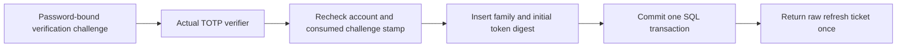

# Platform Administrator session start

Scope: [ADR 0040](../decisions/0040-platform-session-start-and-lifetimes.md), accepted 2026-11-18. Internal session creation after the actual password-bound MFA verifier. Public authentication/authorization and refresh redemption remain pending.

## Important types and learning points

IPlatformSessionStarter defines the narrow operation that a later trusted login boundary can call: StartAsync takes only the existing Verification challenge token, submitted TOTP code, and cancellation token. An interface gives that caller one named capability without exposing transaction and EF details. It does not turn a Boolean, ticket, or public GUID supplied by a client into authentication proof. The contract remains in the existing Identity Infrastructure internal-component pattern; no Application-to-Infrastructure dependency or new project is introduced.

PlatformSessionStarter in ControlPlane Infrastructure owns the real operation. It creates a private context, suppresses inherited logging/sensitive-data settings as in password entry, and rejects System.Transactions ambient ownership. Its own ReadCommitted transaction spans PlatformMfaVerifier, the accepted-step/nonce changes, and both session inserts. A fresh context prevents SaveChanges from also saving unrelated entities in a caller's tracker.

PlatformSessionPolicy contains the accepted Platform-only durations: five-minute access-token maximum (reserved for the future JWT issuer), thirty-minute refresh inactivity, and eight-hour absolute lifetime. TimeProvider supplies server UTC for testable issuance times; no client time/expiry is accepted. The issue time is read after MFA and the subsequent eligibility query. Initial refresh expiry is bounded by the family expiry. Future JWT/refresh workflows must enforce the deadlines, treat equality as expired, and never extend the original absolute deadline.

PlatformSessionStartResult has SessionCreated and nullable Ticket. PlatformSessionTicket exposes only public account/session GUIDs, raw refresh token, and the three timestamps. The read-only, non-record classes avoid generated payload-bearing ToString output. The ticket constructor checks identifier/opaque-token shape and UTC/expiry consistency; those checks do not grant authentication. Never log/destructure/trace these objects or return a placeholder JWT. Managed strings cannot be reliably erased; only mutable cryptographic buffers are cleared.

## Transaction behavior



Wrong/malformed codes and replay denials commit the existing persistent failure counters, including fifth-failure blocking and nonce revocation. Invalid challenges/state return an empty rejection without charging another account. Denials create no family/token.

Successful verification is still provisional. Under the verifier's retained locks, recheck Platform scope, administrator claim, enabled/confirmed MFA and issued backup state, lockout/block state, consumed non-revoked Verification nonce, and exact current account/challenge stamp equality. Use only the server-resolved public subject. If this late check fails, disposal rolls back provisional MFA acceptance; do not adopt a new stamp or changed claim state. Current-account validation/authorization on subsequent requests remains a later required component.

Generate a new 256-bit token with RandomNumberGenerator, encode canonical unpadded base64url, and hash its ASCII representation with SHA-256. No raw refresh token is written to SQL. Both inserts use the existing family/digest/UTC/FK constraints. Validate/build the result before commit so a result-construction error cannot commit an unusable delivery value. The caller observes success only after commit; repeated/parallel consumption of the same challenge cannot create a second session.

Pre-commit SQL, cryptographic, and cancellation errors cause transaction disposal/rollback. SQL/update diagnostics are replaced by a fixed error without inner exceptions; verifier-owned errors retain its existing sanitization. An actual commit acknowledgment loss is inherently uncertain and is not simulated in these tests. Never infer rollback from such an error, automatically retry session creation, or try to redisplay the token from its hash. Lost delivery requires a fresh reviewed sign-in path with the existing replay restrictions.

Each fresh sign-in creates a separate family. It does not revoke or extend previous families, consume their refresh tokens, or choose an account-wide count limit. The thirty-minute window measures refresh use, not human activity: background traffic can keep it alive up to the eight-hour absolute deadline. This component stores expiry values; no refresh handler, JWT, HTTP principal, endpoint, cookie/CSRF mechanism, client, or tenant operational access is enabled here.

## Tests and current verification

PlatformSessionStartResultTests checks the client-input boundary, read-only public delivery surface, rejection/no-ticket behavior, non-disclosing string output, and malformed identifier/token/timestamp rejection. PlatformSessionStarterTests uses real framework password hashing, actual password entry, actual encrypted pending enrollment/confirmation, and published RFC TOTP steps. No fake JWT/authentication implementation stands in for the flow.

SQL coverage includes digest-only account-bound creation and exact approved dates; retry denial; wrong-code counters and block persistence across replacement challenges; expiry/current-state/scope/stamp/factor rejection; matching Organization email with a deliberately seeded factor/challenge denied; independent fresh sessions and replay rejection; simultaneous completion with one winner; SQL insert failure; a real SQL error after both session writes; cancellation after writes; commit gating; ambient/pre-cancellation denial; unreadable/noncanonical secrets; private-context tracker isolation/diagnostic suppression; post-acceptance stamp/claim change rollback; and fresh UTC time after verification or account-lock waits.

The commit probe inspects the same real transaction: pending family/token rows and accepted step are present before commit, while the result task remains incomplete. A separate fault injects a real missing-table SQL error at that point, proving rollback restores both rows and the original nonce/replay/failure budget. The probe exercises pre-commit failure, not network acknowledgment loss or a distributed transaction.

Commands run:

```powershell
dotnet build GeoSurvey.sln --configuration Release --no-restore
dotnet test tests/Unit/GeoSurvey.Identity.Infrastructure.Tests --configuration Release --no-build --no-restore
powershell -NoProfile -ExecutionPolicy Bypass -File scripts/Test-Backend.ps1
dotnet format GeoSurvey.sln --verify-no-changes --no-restore
git diff --check
```

The initial and corrected-fixture Release builds passed with zero warnings/errors. The targeted Identity run passed 194 tests, including sixteen new delivery/contract cases. Formatting/analyzers passed initially and after the fixture fix. The first full run had 594 passes, one failed setup, and zero skips: a new blocked-state test set BlockedUntilUtc while the failure count/window still represented zero failures. The existing CK_MfaVerificationStates_Block constraint rejected that fixture before the starter ran. Corrected only the new test fixture to set five failures and a window start, and verified that denial preserves that preexisting count.

The final full backend rerun passed 595 tests, zero failures/skips: ControlPlane SQL 265, Identity unit 194, Identity SQL 35, Organization SQL 7, Organization unit 38, console unit 24, architecture 13, and API 19. This adds 38 actual-workflow SQL cases and sixteen unit cases. No production code change was needed to resolve the test-fixture failure. Separately, all 153 local links in eight updated documents resolve; new C# whitespace/newlines/UTF-8 and Git whitespace checks passed. The final code/documentation diff was reviewed. These documentation checks do not substitute for the application checks above.

No package or schema changed, so restore and migration generation were not repeated. Existing snapshot/migration tests still run in the full suite. Docker SQL targets are isolated/disposable. No real administrator/production session, deployed API, real certificate, hosted CI, frontend/mobile change, commit, or push is performed.

Next review: JWT signing-key configuration and access-token claims/issuer contract before implementing signed access tokens and request authorization. Refresh rotation/reuse, logout/revocation, public delivery/throttling, and recovery authentication remain later work.
