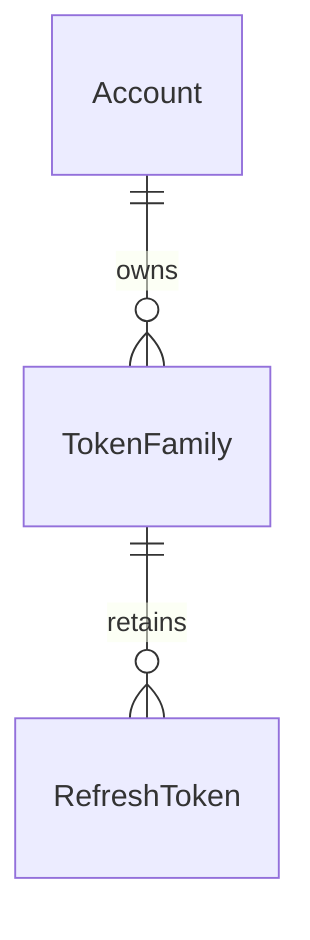

# Session and refresh-token storage

Implemented scope: the [approved persistent storage foundation](../decisions/0039-session-refresh-token-storage.md). Session issuance and token lifecycle workflows remain pending.

## How the code works

TokenFamily represents one account-bound session and the family of refresh tokens associated with it. RefreshToken retains a digest and optional consumption timestamp for each token in that family. For example, consumed A and B may remain beside unconsumed C. This is storage for future reuse detection, not an implemented refresh endpoint.



Both classes live in Identity Infrastructure/Sessions, consistent with the existing Identity persistence models. Private setters and factory methods establish valid initial storage records. TokenFamily.Create generates a public GUID and validates the internal account reference, stamp, UTC timestamps, and positive interval. RefreshToken.Create validates its internal family reference and SHA-256 digest shape, canonicalizes hexadecimal input, and validates UTC/order. Neither factory selects a duration, queries account eligibility, grants permissions, generates a bearer token, or consumes/revokes a record. Default ToString does not include stored values.

TokenFamilyConfiguration and RefreshTokenConfiguration implement IEntityTypeConfiguration<T>. EF uses these classes to translate the storage types into SQL columns, indexes, constraints, and relationships. They are composed only into GlobalControlPlaneDbContext. No Domain/Application dependency, Identity-only context mapping, package, host registration, API route, or authentication service changes.

The family SecurityStamp is a snapshot for later comparison with the account's current credential version. PublicId is a lookup identifier, never a credential. AccountId and TokenFamilyId remain internal server-side references; no tenant database name or connection string is present.

## Database guarantees and workflow limits

- Unique public family GUID and token digest; required nonempty stamp; canonical uppercase 64-character hexadecimal digest in binary-collated char(64).
- Positive expiry interval and datetimeoffset(7) UTC storage, including optional revocation/consumption times; state timestamps cannot precede creation.
- NO ACTION account/family relationships. Parent deletion is blocked while dependent rows exist; no cascade cleanup or final retention period is introduced.
- At most one unconsumed token per family. The filtered index uses ConsumedAtUtc IS NULL, independent of current time or family revocation. Consumed rows remain stored, and different families may each hold an unconsumed token.

These constraints do not implement current account/Platform Administrator authorization, MFA acceptance, parent-expiry checks, immutable account/stamp binding, legal consumption/revocation, or refresh concurrency/replay policy. A foreign key proves referential integrity, not access rights. Later sign-in completion must persist the family/initial token with the real MFA verifier in one transaction and return credentials only after commit. Storage rollback tests do not claim that integration is complete.

## Migration and affected tests

20261118070921_AddTokenFamiliesAndRefreshTokens adds identity.TokenFamilies and identity.RefreshTokens; the reviewed [forward SQL](sql/add-token-families-and-refresh-tokens.sql) contains only their creation, indexes, constraints, and migration-history entry. Existing tables are unchanged. There are now seven migrations, thirteen application tables, fourteen including migration history, and twelve NO ACTION foreign keys. The generated Down method is not executed against application data in this task.

Existing global model/API registration/migration-count tests are updated only for the newly composed mappings. The Identity-only model explicitly excludes both new types and still contains exactly its four reviewed tables. MigrationDatabase gains a sixth-migration fixture to seed a populated pre-upgrade database.

SessionStorageModelTests covers invalid associations, stamps, digest shape/canonicalization, expiry boundaries, nonzero offsets, independent GUIDs, and non-disclosing default strings. SessionStorageTests exercises actual migrated SQL: roundtrip precision and reviewed columns; unique/public/hash constraints; NULL/format/UTC/chronology rejection after bypassing factories; FK and parent-deletion guards; retained consumed history; independent families; expired/revoked slot occupancy; concurrent initial insertion; and rollback of newly inserted family/token rows.

SessionStorageUpgradeTests starts at the sixth migration with separate same-email Platform/Organization accounts, a real test password hash, existing MFA ciphertext/backup/control/challenge/claim data, an organization, and bootstrap history. It verifies preserved data and empty session tables after upgrade, then verifies that reapplying the latest migration preserves synthetic consumed/current token history and family revocation. Those rows are test fixtures, not issued sessions or a fake authentication implementation.

## Verification

```powershell
dotnet build GeoSurvey.sln --configuration Release --no-restore
dotnet test tests/Unit/GeoSurvey.Identity.Infrastructure.Tests --configuration Release --no-build --no-restore
powershell -NoProfile -ExecutionPolicy Bypass -File scripts/Test-Backend.ps1
dotnet format GeoSurvey.sln --verify-no-changes --no-restore
git diff --check
```

The Release build passed with zero warnings/errors, including a rebuild after migration generation. The targeted Identity run passed all 178 tests, including seventeen new storage-model cases. The full backend run passed 541 tests, zero failures/skips: ControlPlane SQL 227, Identity unit 178, Identity SQL 35, Organization SQL 7, Organization unit 38, console unit 24, architecture 13, and API 19. This adds 36 storage SQL cases, one populated-upgrade/reapplication case, and seventeen unit cases. Formatting/analyzers passed. No build or test failed in this slice. Separately, eight updated documents had 148 resolving local links; new C# encoding/newlines/whitespace and Git diff checks passed, and the final code/migration/documentation diff was reviewed. These documentation checks are not substitutes for the build and test results above.

Migration and forward SQL were generated using the existing offline design-time connection, without connecting to an application database. No dependency changed, so restore was not repeated. Docker tests use isolated disposable databases; no real administrator, production migration/deployment, hosted CI, frontend/mobile change, commit, or push is performed.

With GEOSURVEY_DESIGNTIME_SQLSERVER temporarily set to the existing offline design connection and restored afterward, the EF commands were:

```powershell
dotnet ef migrations add AddTokenFamiliesAndRefreshTokens --project src/Backend/GeoSurvey.ControlPlane.Infrastructure --startup-project src/Backend/GeoSurvey.ControlPlane.Infrastructure --context GlobalControlPlaneDbContext --output-dir Migrations --configuration Release --no-build
dotnet ef migrations script 20261117174212_AddConfirmedMfaEnrollment 20261118070921_AddTokenFamiliesAndRefreshTokens --project src/Backend/GeoSurvey.ControlPlane.Infrastructure --startup-project src/Backend/GeoSurvey.ControlPlane.Infrastructure --context GlobalControlPlaneDbContext --configuration Release --output docs/development/sql/add-token-families-and-refresh-tokens.sql
```

The first command used the initial successful Release build; the second rebuilt the migration assembly. The final solution build refreshed all test output copies before the full suite. Generated C# files/snapshot use UTF-8 without BOM, matching the repository encoding rule.

The next small review should select Platform Administrator session lifetimes and the internal issuance contract before implementing the coordinator. Signing keys, access-token validation/authorization, refresh/reuse workflows, public APIs, cookies/CSRF, and recovery authentication remain later decisions.
