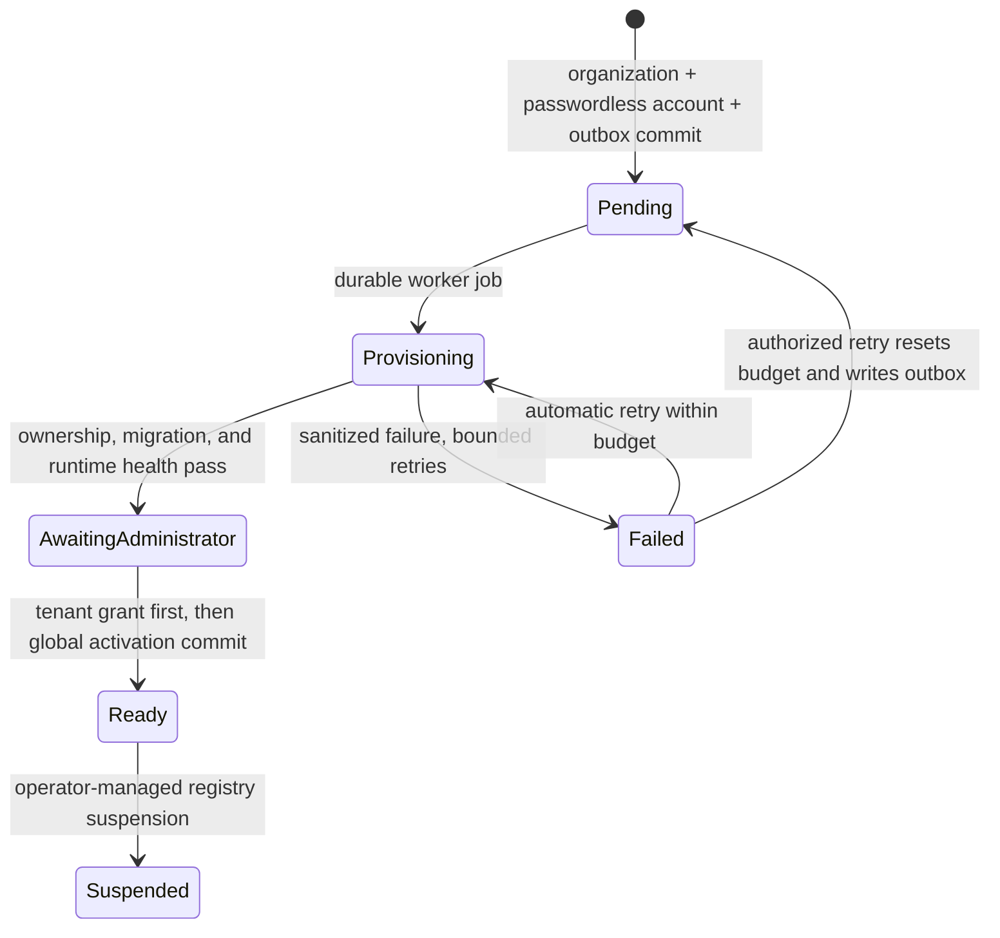

# Phase 1 tenant provisioning and administrator activation

Implemented within the approved [submission delivery plan](phase-1-submission-delivery-plan.md). The public shapes are defined in the [integration contract](../architecture/phase-1-integration-contracts.md). This baseline introduces organization setup only; later survey, GIS, project, and general RBAC schemas remain outside Phase 1.

`Organizations.Application` defines organization management DTOs and operations without EF or ASP.NET types. `Tenancy.Application` defines the administrator-access, setup, provisioning, outbox, and database-operation boundaries. The global persistence adapter owns organization/identity/registry transactions. The tenant adapter opens a new context for one trusted database at a time. The worker is a separate executable so the HTTP process has no database-creation credential.

## Durable flow

There is no suspension-management HTTP endpoint in this slice. An existing Suspended registry entry is enforced by all tenant access checks.

Organization creation atomically writes the organization, its independent passwordless account, the registry entry, an outbox message, and an audit event. A BackgroundService dispatches pending outbox rows into Hangfire SQL Server storage. Dispatch is at least once: a crash after enqueue but before marking a message dispatched can produce duplicate jobs. The worker's registry lock and idempotent database checks make duplicate execution safe. Jobs contain only the organization's public GUID.

Each worker execution acquires an organization-specific SQL application lock. Provisioning is bounded to four attempts, with Hangfire delays of 10, 30, and 90 seconds after the initial attempt. A manual retry is available only from Failed, resets that budget, and writes a new durable outbox message. Failed databases are preserved.

## Tenant baseline and ownership

The versioned baseline is `20261118081634_InitialTenantBaseline`. It contains:

- `tenant.OrganizationIdentity`: one immutable organization GUID, schema version 1, and UTC creation timestamp.
- `tenant.AdministratorGrants`: tenant-owned initial administrator grants keyed by global account public GUID.
- `tenant.__TenantMigrations`: EF migration history.

The configured database prefix plus the server-generated organization public GUID determines the database name. The adapter validates both the trusted profile and the exact generated name before opening any target. Creation uses the separate management connection. A database-level `GeoSurvey.OrganizationPublicId` extended property records ownership before migrations. Existing databases must carry the matching property; provisioning never automatically adopts or deletes an unowned database. Context reads additionally verify the versioned identity table.

A process interruption after tenant migrations/identity insertion but before the global status commit resumes the same database. There is a narrow interruption window between SQL Server's database creation and writing its ownership extended property because CREATE DATABASE cannot share the global transaction. Such a database remains preserved and fails closed. An authorized operator must establish ownership from the registry and server creation evidence before repairing that property and retrying. The HTTP API has no ownership-repair endpoint or automatic adoption path.

The worker maps the pre-existing configured runtime SQL login into each new tenant database. The runtime user can select the identity marker and select/insert administrator grants. It cannot modify the marker, alter schema, create databases, or update/delete administrator grants. Broad lifecycle management remains an operator/worker responsibility.

## Invitation and activation consistency

The platform administrator issues a 24-hour random 256-bit activation token only after the tenant is AwaitingAdministrator. Only its SHA-256 digest is persisted. Reissuing revokes any unused invitation. The raw token is returned once, with Cache-Control no-store, for manual handoff. The browser places it in a fragment and removes that fragment before inspecting it; POST bodies and CSRF protection are used for inspection/completion.

Activation reuses the existing NFC-normalized 15-128 Unicode-code-point password policy and verified local blocklist. It never overwrites an account that already has a password. Activation verifies tenant health and commits the initial administrator grant in that tenant database first. Only afterward does a global transaction set the password hash, rotate stamps, consume the invitation, append the audit event, and change the registry to Ready. A failed global commit leaves a passwordless account and an idempotent, resumable grant. The unfinished account cannot sign in or access a workspace. No distributed transaction is required.

Every authenticated tenant request resolves the current global account's own organization and Ready registry entry, validates the server-managed database reference, opens a fresh tenant context, verifies its identity marker, and checks that account's tenant-owned administrator grant. Platform scope, another organization's public ID, client database selectors, mismatched markers, missing grants, suspended organizations, and database availability failures do not grant access.

## Configuration and dependencies

The API requires only `Tenancy:LocalDemo:RuntimeConnectionString` and the server-controlled local profile (`RegionKey=local-demo`, display name, database prefix, and `RuntimeLogin=GeoSurveyRuntime`). The worker additionally requires `Tenancy:LocalDemo:ManagementConnectionString`, `ConnectionStrings:GlobalControlPlane`, and `ConnectionStrings:ProvisioningJobs`. Global and jobs databases/logins must be initialized before starting the worker. Secrets belong in external environment/configuration, never committed files.

Tenancy uses the repository's EF Core SQL Server/Design 10.0.9 and cryptography compatibility pin 10.0.15. Worker hosting comes from the installed ASP.NET shared framework. [Hangfire.NetCore 1.8.25](https://www.nuget.org/packages/Hangfire.NetCore/1.8.25) and [Hangfire.SqlServer 1.8.25](https://www.nuget.org/packages/Hangfire.SqlServer/1.8.25) provide durable background jobs. [Newtonsoft.Json 13.0.4](https://www.nuget.org/packages/Newtonsoft.Json/13.0.4) explicitly replaces Hangfire's vulnerable lower-bound transitive version. No paid Hangfire dependency or public dashboard is introduced.

## Verification

Executed during implementation:

- `dotnet build src/Backend/Modules/Tenancy/GeoSurvey.Tenancy.Infrastructure/GeoSurvey.Tenancy.Infrastructure.csproj -c Release --nologo`: passed; NU1900 indicated vulnerability-source network access was unavailable in the sandbox.
- `dotnet ef migrations add InitialTenantBaseline --project src/Backend/Modules/Tenancy/GeoSurvey.Tenancy.Infrastructure --output-dir Migrations --no-build --configuration Release`: generated the versioned baseline using an explicit design-time connection environment variable; no database connection or migration application was performed by this command.
- `dotnet restore src/Backend/GeoSurvey.Provisioning.Worker/GeoSurvey.Provisioning.Worker.csproj -m:1 --disable-parallel`: passed with network-enabled execution. The first sandbox attempt failed NU1301. The initial successful restore reported vulnerable Newtonsoft.Json 11.0.1; the 13.0.4 pin removed that warning on the subsequent restore.
- `dotnet build src/Backend/GeoSurvey.Provisioning.Worker/GeoSurvey.Provisioning.Worker.csproj -c Release --no-restore -m:1 --nologo`: passed.
- `dotnet build src/Backend/GeoSurvey.Api/GeoSurvey.Api.csproj -c Release --no-restore -m:1 --nologo`: passed after the final organization endpoint/OpenAPI changes; one cached NU1900 vulnerability-source warning remained.
- `dotnet build tests/Integration/GeoSurvey.Tenancy.IntegrationTests/GeoSurvey.Tenancy.IntegrationTests.csproj -c Release -m:1 --nologo`: passed; NU1900 network warnings remained in cached restore results.

The new SQL integration tests cover durable creation, real migrations, repeated provisioning, invitation replacement/expiry/single use, two independent same-email administrators, database/tenant isolation, runtime SQL permissions, marker corruption, suspension, lost grants, global-commit failure with resumable activation, outbox failure, duplicate jobs, worker restart, unowned-database preservation, and bounded retry.

Executed with a newly created, randomly named SQL Server 2022 container and fresh random credentials, with the connection supplied only through `GEOSURVEY_TEST_SQLSERVER`:

- `dotnet test tests/Integration/GeoSurvey.Tenancy.IntegrationTests/GeoSurvey.Tenancy.IntegrationTests.csproj -c Release --no-restore -m:1 --logger 'console;verbosity=normal'`: **9 passed, 0 failed**, 51.0 seconds. The disposable container was removed by the runner's finally block.
- The initial SQL run reported 6 passed and 3 failed. One test used an invalid SQL server-permission metadata query, which returned DBNull; it now attempts CREATE DATABASE directly against a fixture-owned disposable target and proves rejection. Two tests read migration history through the intentionally restricted runtime user; migration-history assertions now use the management connection. No production permissions were broadened to fix those assertions.
- `dotnet format whitespace GeoSurvey.sln --no-restore --include src/Backend/Modules/Organizations/GeoSurvey.Organizations.Application src/Backend/Modules/Tenancy src/Backend/GeoSurvey.ControlPlane.Infrastructure/Tenancy src/Backend/GeoSurvey.Api/Organizations src/Backend/GeoSurvey.Provisioning.Worker tests/Integration/GeoSurvey.Tenancy.IntegrationTests --verbosity minimal`: passed with a workspace-loading warning. The sandboxed attempt could not access the formatter's build-host named pipe; the network/host-enabled retry completed.
- `dotnet format GeoSurvey.sln --no-restore --include src/Backend/Modules/Organizations/GeoSurvey.Organizations.Application src/Backend/Modules/Tenancy src/Backend/GeoSurvey.ControlPlane.Infrastructure/Tenancy src/Backend/GeoSurvey.Api/Organizations src/Backend/GeoSurvey.Provisioning.Worker tests/Integration/GeoSurvey.Tenancy.IntegrationTests --verify-no-changes --verbosity minimal`: passed after the final changes, with the same workspace-loading warning.

These targeted SQL results establish the listed persistence and isolation behaviors. Full-stack HTTP/browser, full backend-suite, Docker startup, and submission validation remain separate evidence maintained by the delivery coordinator.
