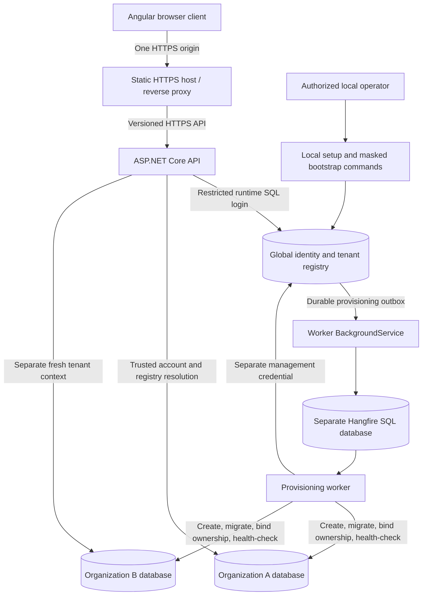

# Phase 1 architecture overview

This submission implements the approved local Phase 1 delivery: Platform Administrator bootstrap and MFA, organization creation, durable provisioning of a separate database, initial administrator activation, and authenticated tenant setup. The [master specification](../../../GeoSurvey_Master_Architecture_and_Codex_Spec.md) remains the requirements baseline. The [approved delivery plan](../../development/phase-1-submission-delivery-plan.md) defines this batch, and the [integration contract](../../architecture/phase-1-integration-contracts.md) defines the public API. Final Docker and browser execution results are maintained by the delivery coordinator; this architecture description is not execution evidence.

## Components and boundaries

The backend remains a modular monolith. The API is the HTTP/composition boundary; the worker runs separately to keep database-creation privileges out of that boundary. Domain has no EF, HTTP, or infrastructure dependency. Application contracts contain public DTOs and abstractions without framework types. Identity and organization persistence are composed in the global control plane; tenant storage is accessed through explicit Tenancy application contracts. No survey, project, or general RBAC implementation is added by this phase.

The Angular client uses standalone components, forms, services/RxJS, and ordinary CSS. The local static host exposes the browser and API under one HTTPS origin. Refresh credentials stay in host-only HttpOnly/Secure/SameSite cookies; access tokens and temporary enrollment/invitation material stay in browser memory. The client coordinates refreshes across tabs, while server-side checks remain the authorization authority. See the [frontend handover](frontend-flow.md) for browser behavior and its independently recorded validation limits.

## Global and tenant schemas

The global migration sequence advances from **seven to eight migrations**. Migration `20261118092155_AddTenantProvisioningAndActivation` adds four tables to the prior 13-table application model. The current global model contains **17 application tables**, **18 tables including migration history**, and **17 foreign keys with NO ACTION deletion behavior**. These counts exclude the separate Hangfire jobs database.

| Global schema | Application tables | Purpose |
| --- | --- | --- |
| `organization` | `Organizations` | Stable organization public identity, unique normalized login code, display name |
| `identity` | `Accounts`, `AccountClaims`, `AccountLogins`, `AccountTokens` | Independent Platform/Organization accounts and supporting identity storage |
| `identity` | `MfaChallenges`, `PendingTotpEnrollments`, `MfaVerificationStates`, `TotpCredentials`, `MfaRecoveryCodes` | Restricted challenges, protected TOTP enrollment, persistent failure/replay budgets, confirmed factors, digest-only recovery codes |
| `identity` | `TokenFamilies`, `RefreshTokens` | Server-bound sessions, single-use refresh rotation, retained consumption/revocation evidence |
| `controlplane` | `BootstrapCompletion` | Permanent one-time first-administrator bootstrap completion |
| `tenancy` | `TenantRegistry`, `AdministratorInvitations`, `ProvisioningOutbox` | Trusted server database references, lifecycle, digest-only invitations, durable provisioning publication |
| `audit` | `TenantLifecycleAudit` | Append-only lifecycle/security events without credential or database-target payloads |

`controlplane.__EFMigrationsHistory` is the eighteenth global table. Internal integer keys remain storage details; public routes and DTOs use GUID PublicId values. Account email uniqueness is scoped to Platform or the resolved organization. The same email in two organizations represents separate account rows and credentials.

Every organization has a separate physical operational database. Tenant migration `20261118081634_InitialTenantBaseline` creates **two application tables**: `tenant.OrganizationIdentity` and `tenant.AdministratorGrants`. `tenant.__TenantMigrations` is the additional migration-history table. The identity table contains exactly one immutable organization GUID, schema version 1, and a UTC creation timestamp. The grant table stores only the initial administrator authorization needed for Phase 1. There are no fabricated parcels, surveys, operational datasets, or empty later-phase module schemas.

## Authentication and tenant resolution

An authorized operator creates the first Platform Administrator through the masked bootstrap command; there is no public bootstrap endpoint or default account. Platform sign-in requires password plus confirmed TOTP or one unused issued recovery code. An Enrollment challenge is limited proof and cannot administer organizations. RS256 access-token signing uses an RSA key separate from Data Protection. The server validates signature, issuer, audience, lifetime, account/security stamp, token family, scope, and current permissions.

Organization users sign in with organization code, email, and password. The code identifies the intended organization for scoped credential lookup. It does not authorize a tenant or select a SQL target. Each subsequent tenant request starts from the signed subject's current global account, resolves its current Ready registry entry, derives the expected target from the trusted local server profile, opens a fresh context, verifies the database's organization marker, and checks that account's tenant-owned administrator grant. Platform sessions do not grant tenant operational access. Client headers, route substitutions, query strings, or supplied database names cannot override resolution.

Refresh rotation is strictly single use. Reuse revokes the family immediately, with no replay grace period. Server-side family/account checks invalidate already issued access tokens on revocation. The accepted lifetimes remain five-minute access, thirty-minute refresh inactivity, and an eight-hour absolute session limit. Account/password/MFA lockout and replay controls remain persistent across challenges.

## Provisioning and activation

Organization creation atomically commits the organization, a passwordless independent administrator account, its trusted registry entry, an outbox message, and an audit event. The worker dispatcher publishes outbox rows to durable Hangfire SQL storage. Publication is at least once; duplicate jobs are safe because organization-specific SQL application locks serialize work and each run revalidates ownership and schema state.

The lifecycle is Pending → Provisioning → AwaitingAdministrator → Ready, with Failed and Suspended enforced. Provisioning has at most four attempts per retry request; Hangfire delays the three retries by 10, 30, and 90 seconds. Authorized manual retry from Failed resets the budget and creates another durable outbox message. Failed databases are preserved. A completed tenant migration followed by an interrupted global status write resumes the same database.

Database names are generated from server configuration and the organization's generated GUID. A database-level ownership extended property is checked before adopting an existing target, and the versioned identity table is checked when using a tenant context. The worker maps the configured runtime login into the tenant database, granting marker SELECT and grant SELECT/INSERT. The runtime login cannot create a database, change schema, mutate the identity marker, or update/delete grants. Hangfire uses its own dedicated jobs-database principal. The local worker management credential is privileged and must be independently constrained for production deployment.

There is a narrow interruption window between CREATE DATABASE and writing its ownership property. An existing target without the matching property is preserved and fails closed. An authorized operator must verify ownership against the registry and server creation evidence before repairing the property and retrying. There is no automatic adoption/deletion or public repair endpoint. See [known limitations](known-limitations.md).

A Platform Administrator issues a random, 24-hour, single-use activation link for manual secure handoff. Only a SHA-256 digest is stored; reissue revokes any unused old invitation. The recipient chooses their own password using the existing NFC-normalized 15–128 Unicode-code-point policy and verified local blocklist. Activation first commits the tenant administrator grant, then atomically enables the global password, consumes the invitation, records the audit event, and marks the registry Ready. If the global transaction fails, the account stays passwordless and activation can resume against the existing grant. An active account is never overwritten. This ordering avoids a distributed transaction and fails closed on incomplete setup.

## Evidence boundary

The targeted real SQL tenancy suite passed **9/9 tests** in its disposable SQL Server 2022 environment; API/worker Release builds and scoped formatting verification also passed. Exact commands, initial failures and corrections, and dependency details are recorded in [tenant provisioning verification](../../development/tenant-provisioning-and-activation.md). The [acceptance matrix](acceptance-matrix.md) separates this evidence from full-suite, local Docker, browser, fresh-checkout, and package checks that the delivery coordinator must record.
